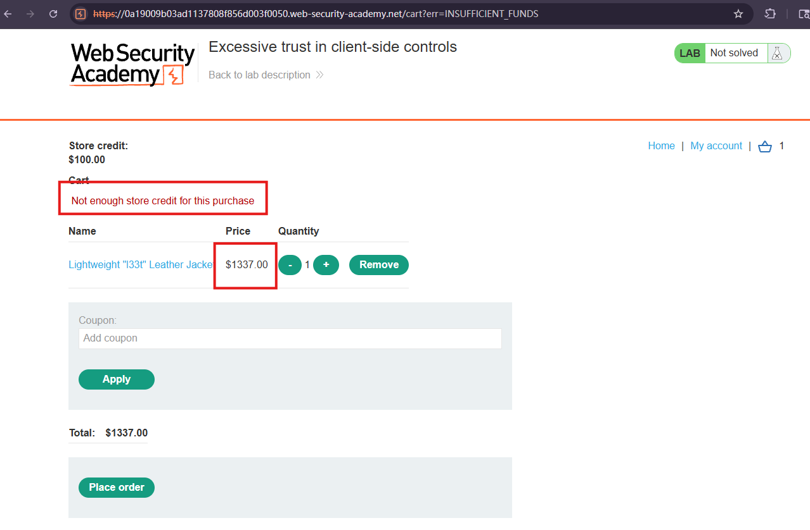
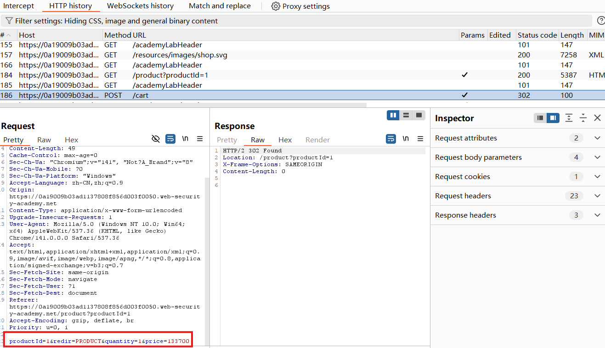
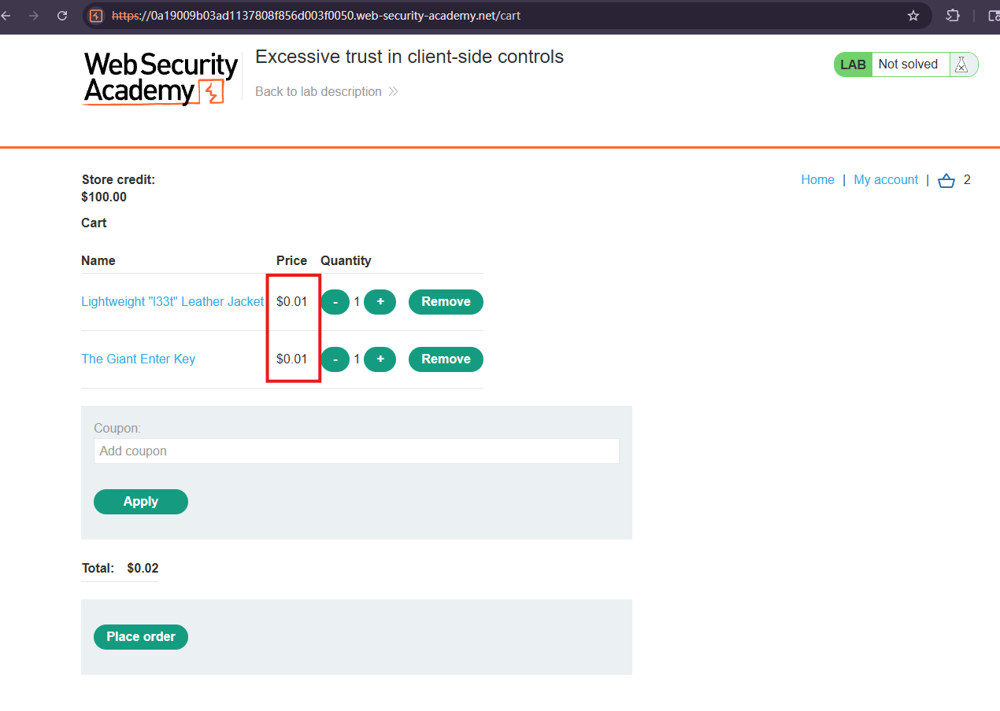
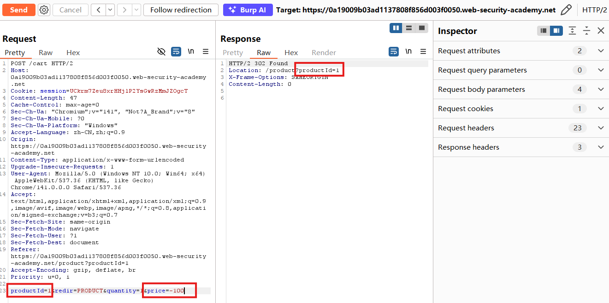
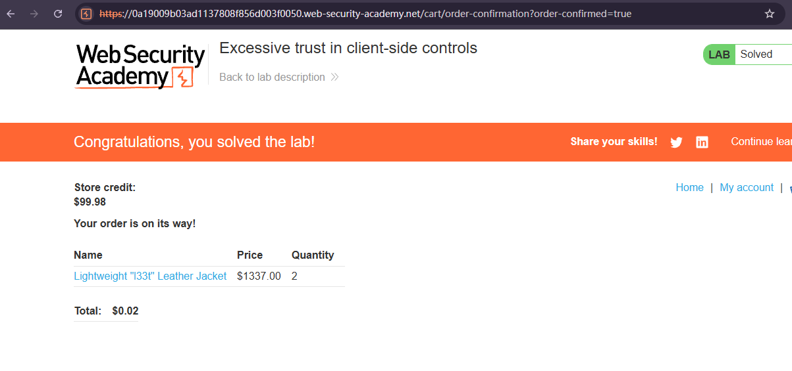

# Excessive trust in client-side controls

## Description
This lab doesn't adequately validate user input. You can exploit a logic flaw in its purchasing workflow to buy items for an unintended price. To solve the lab, buy a "Lightweight l33t leather jacket".

You can log in to your own account using the following credentials: wiener:peter

## Solution
1. Log in and attempt to buy the leather jacket. The order is rejected because you don't have enough store credit.

2. In HTTP history, find the `POST` request for`/cart`, we can see at the bottom of the request body, it contains productID, quantity and price, which means we can sent it to Repeater and later modify it.

3. In Repeater, modify the price to `1` and see the response is `302 Found`.Refresh the cart and confirm that the item price is now $0.01. This indicates that the price parameter is interpreted in cents and that the server accepts the modified value.

4. However, when I send negative value of quantity or price, my cart will be cleared, which means we cannot get refund in this way.

5. Luckily, we can buy 2 jacket only spent $0.02.

## Question

## Conclusion