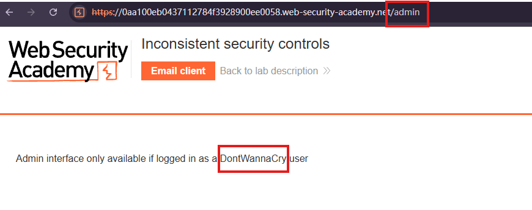
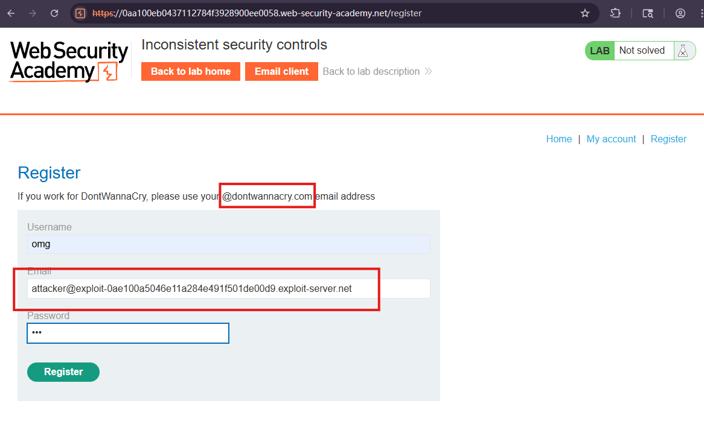
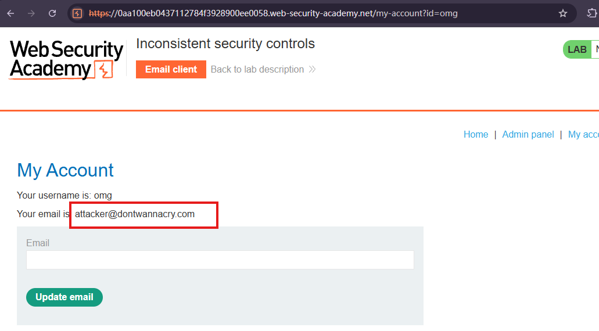
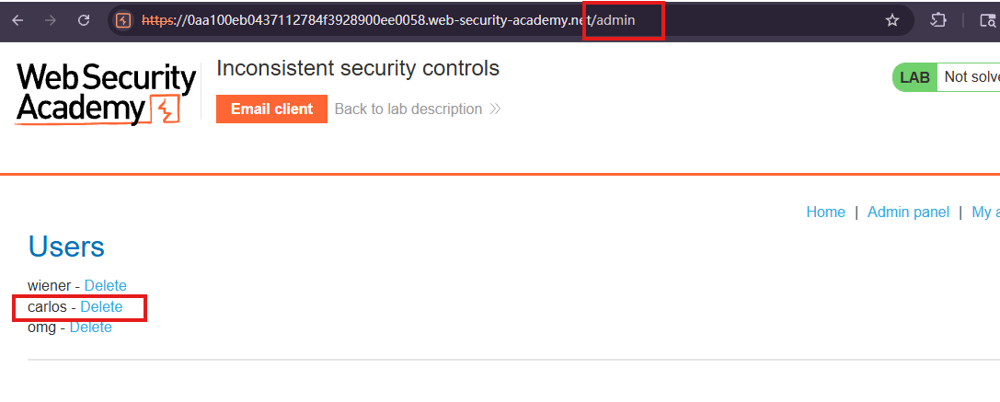

# Inconsistent security controls

## Description
This lab's flawed logic allows arbitrary users to access administrative functionality that should only be available to company employees. To solve the lab, access the admin panel and delete the user carlos.

## Solution
1. Try and browse to `/admin`. Although you don't have access, the error message indicates that `DontWannaCry` users do.

2. Go to the account registration page. Notice the message telling DontWannaCry employees to use their company email address `@dontwannacry.com`.
However we just register with our attacker email address, and later change it to dontwannacry.

3. After checking the email to complete the registration, 
we can change email address to an arbitrary `@dontwannacry.com` address.

4. Now we have access to the `admin panel`, and can delete carlos to solve the lab.

## Question

## Conclusion