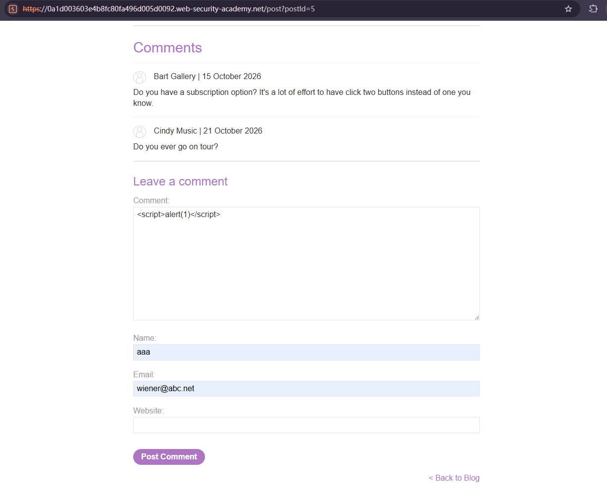

# Stored XSS into HTML context with nothing encoded

## Description
This lab contains a stored cross-site scripting vulnerability in the comment functionality.
To solve this lab, submit a comment that calls the alert function when the blog post is viewed.

## Solution
1. Open a post, enter `` into the comment box

2. Fill in the required fields, such as name and email, and click Post comment.
3. Go back to the blog. When the page loads, an alert dialog displaying 1 appears, confirming that the injected JavaScript has executed.

## Question
1. WHY is this classified as **stored XSS**?
The application stores the submitted comment and includes it in subsequent responses when the blog post is viewed. The payload can execute when a visitor opens the affected post without the attacker submitting it again.

2. Is **front-end validation** sufficient to prevent this vulnerability?
No. An attacker can bypass front-end checks by **modifying the HTTP request** with a tool such as Burp Repeater or by sending a request directly. So we need to do the **server-side input validation** and appropriate output encoding.

3. How should comments be rendered safely?
If comments are intended to contain plain text, apply **HTML encoding** when inserting them into the HTML text context. For example, the payload should appear in the HTML source as:
`&lt;script&gt;alert(1)&lt;/script&gt;`
The browser then displays the script markup as text instead of executing it

## Conclusion
1. Stored XSS occurs when an application stores untrusted input and later renders it unsafely.

2. The root cause in this lab is **missing HTML output encoding** when displaying comments.

3. **Front-end validation** and **character blacklists** are insufficient defenses. Use **context-appropriate output encoding**, or HTML sanitization when HTML content is intentionally supported.

4. The alert demonstrates JavaScript execution. In a real application, XSS could allow an attacker to access page content or perform actions using the victim's session.