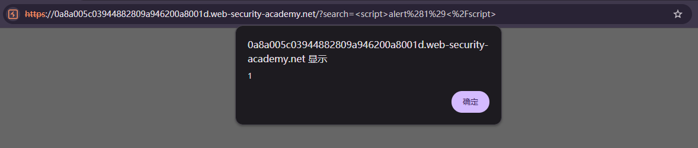

# Reflected XSS into HTML context with nothing encoded

## Description
This lab contains a simple reflected cross-site scripting vulnerability in the search functionality.
To solve the lab, perform a cross-site scripting attack that calls the alert function.

## Solution
1. Input `` into the search box
2. Successfully calls the alert function.

## Question
1. Why does the payload execute?
The application includes the search term in the returned HTML without appropriate **output encoding**. The browser therefore interprets `<script>` as an HTML tag and executes its contents instead of displaying the input as plain text.

2. How does reflected XSS differ from stored XSS?
- In reflected XSS, the payload is supplied in a request and included unsafely in the corresponding response. It does **not need to be saved by the application**.
- In stored XSS, the application **stores the payload**, such as in a comment, and includes it in later pages viewed by users.

## Conclusion
1. Apply context-appropriate **output encoding**.
Encode the search term when inserting it into the HTML text context.
For example this displays the payload as text instead of executing it:
`&lt;script&gt;alert(1)&lt;/script&gt;`

2. Use **safe rendering mechanisms**.
Keep template auto-escaping enabled. When updating the page with JavaScript, use textContent for plain text rather than inserting untrusted input through innerHTML.

3. Do not rely on **front-end validation** or **character blacklists**.
Front-end checks can be bypassed, and blocking selected characters or the word script is not a reliable general defense. Server-side validation can enforce input requirements, but it does not replace safe output handling.

4. Use **Content Security Policy (CSP)** as an additional layer.
A properly configured CSP can restrict script execution and reduce the impact of some XSS vulnerabilities. It should supplement, rather than replace, output encoding.