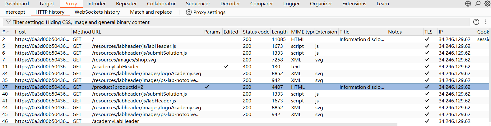
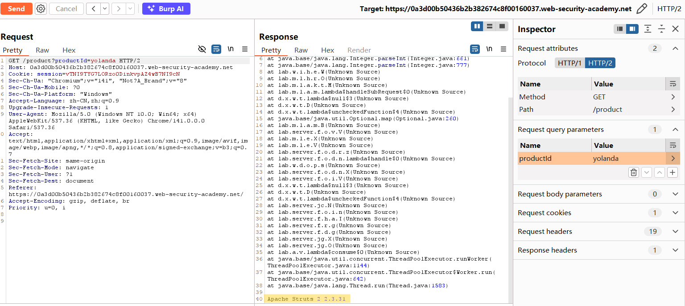

# Information disclosure in error messages

## Discription
This lab's verbose error messages reveal that it is using a vulnerable version of a third-party framework. To solve the lab, obtain and submit the version number of this framework.

## Solution
1. Choose a product and forward the GET request
2. Find '/product?productid=2' and send to Repeater

3. Modify the productid to a non-integer, such as 'productid=yolanda'
4. At the end of the Resonse we can find the version number of this framework, which is 'Apache Struts 2 2.3.31'

## Question
WHY we want to get the version number of the framework?
1. 

## Conclution
1. 
