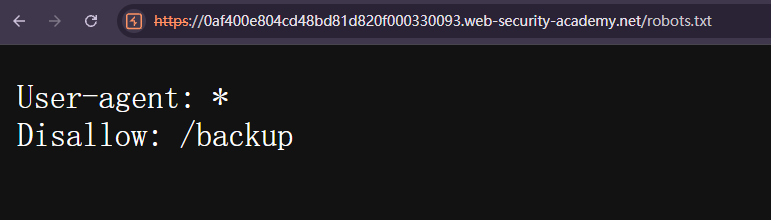
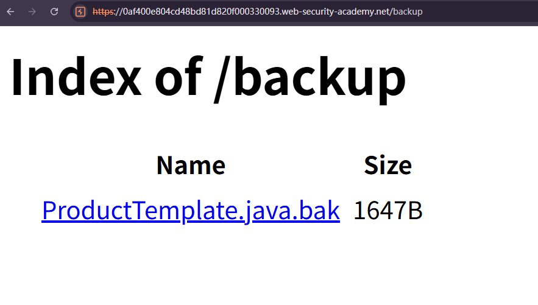
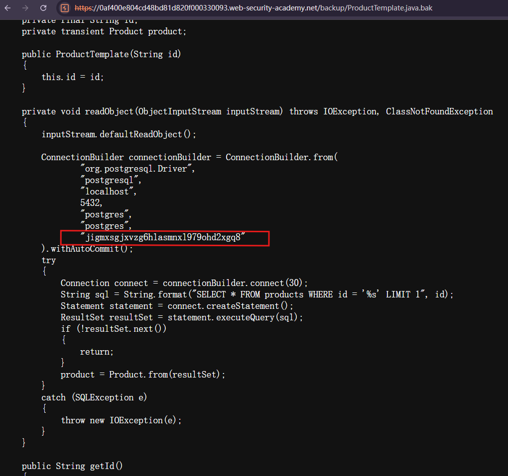

# Source code disclosure via backup files

## Description
This lab leaks its source code via backup files in a hidden directory. To solve the lab, identify and submit the database password, which is hard-coded in the leaked source code.

## Solution
1. Visit `/robots.txt` at the root of the lab website.Notice that it contains a rule referring to `/backup`.

2. Browse to `/backup`. The directory listing reveals a file named `ProductTemplate.java.bak`.

3. click `ProductTemplate.java.bak` and read the source code

4. Find the database connection configuration.It includes the database host, port, database name, username,and a hard-coded password.

## Question
1. WHY does visiting robots.txt reveal a hidden directory?
The `robots.txt` file provides crawling rules for web crawlers.
For example:
```text
User-agent: *
Disallow: /backup/
```
This asks all crawlers that follow these rules not to crawl `/backup/`. However, `robots.txt` is publicly readable. By listing the path, the website also reveals it to visitors, including attackers.

2. WHY is ProductTemplate.java.bak important?
The `.bak` extension usually indicates a backup file:
```text
ProductTemplate.java      Original Java source file
ProductTemplate.java.bak  Backup copy of the source file
```
A backup may contain readable source code and sensitive information, so it should be stored outside publicly accessible web directories.

In this lab, the code connects to a PostgreSQL database and retrieves product information. Its connection configuration exposes a database username and password.
However, obtaining the password does not automatically give an attacker
database access. The database must also be reachable, the credentials
must still be valid, and the account's permissions determine what
actions are allowed.`localhost` in this code refers to the environment running the application, not the attacker's computer.

3. WHY we can find ProductTemplate.java.bak?
- **Directory listing:** Visiting `/backup` displays the file names,
  allowing us to discover `ProductTemplate.java.bak`.
- **Public file access:** The server allows us to request the backup
  file and read its contents without authentication.
Disabling directory listing prevents visitors from browsing the file
list, but it does not necessarily prevent direct access to a file.
If the file remains publicly accessible, someone who knows or guesses
its full path may still download it.

## Conclusion
1. Store source code backups **outside publicly accessible web directories** and **exclude them from website deployments**.
2. **Deny unauthorized access** to sensitive directories and files. Do not rely on hidden paths or `robots.txt` for protection.
3. **Disable unnecessary directory listing**, while also restricting direct access to sensitive files.
4. Avoid hard-coding passwords in source code. Use a secrets manager or appropriately protected configuration.
5. Rotate any exposed database credentials. Removing the backup file does not make a leaked password secret again.