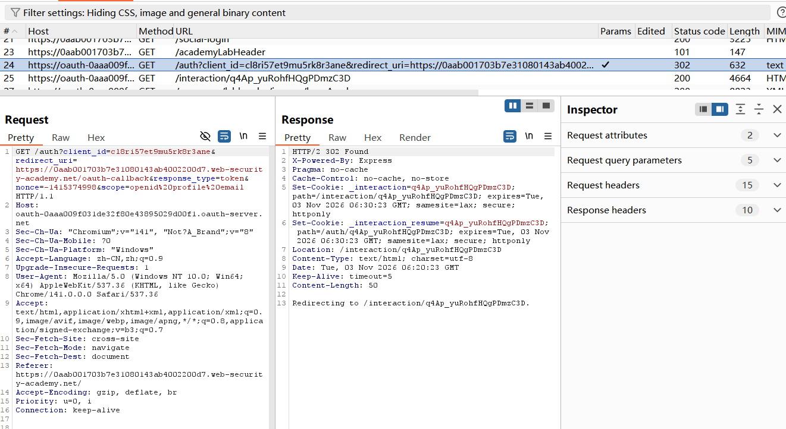
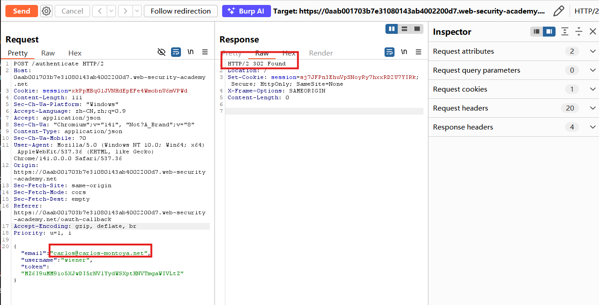
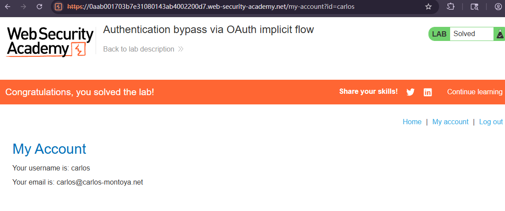

# Authentication bypass via OAuth implicit flow

## Description
This lab uses an OAuth service to allow users to log in with their social media account. Flawed validation by the client application makes it possible for an attacker to log in to other users' accounts without knowing their password.

To solve the lab, log in to Carlos's account. His email address is carlos@carlos-montoya.net.

You can log in with your own social media account using the following credentials: wiener:peter.

## Solution
1. Click "My account" and complete the OAuth login process, you will be redirected back to the blog website.
2. In HTTP history, the requests starts from the authorization request `GET /auth?client_id=...&redirect_uri=....`

3. The client application (the blog website) receives some basic information about the user from the OAuth service. It then logs the user in by sending a `POST` request containing this information to its own `/authenticate` endpoint, along with the `access token`.
```json
{
  "email": "wiener@example.com",
  "username": "wiener",
  "token": "WIENER_ACCESS_TOKEN"
}
```
This request is used by the blog application to establish a local authenticated session.
4. Send the `POST /authenticate` request to Burp Repeater. In Repeater, change the **email address** to `carlos@carlos-montoya.net` while keeping the original access token unchanged, and send the request. 
Observe that you do not encounter an error.
This suggests that the application does **not properly verify** whether the **supplied email address** belongs to the user represented by the **access token**.

5. Right-click on the POST request and select "Request in browser" > "In original session". Copy this URL and visit it in the browser. You are logged in as Carlos and the lab is solved.


## Question
1. WHY can we log in as Carlos simply by **changing the email address**?
The vulnerability occurs because the client application **trusts the email address** supplied in the authentication request **without properly verifying** its **relationship to the OAuth access token**.
Under normal circumstances, the application should verify the token and obtain the associated user's identity from a **trusted OAuth provider**.
However, the application allows the browser to submit user identity information directly to its `/authenticate` endpoint.
An attacker can therefore change:
`email": "wiener@example.com` to `email": "carlos@carlos-montoya.net`
without changing the access token.
The server then incorrectly establishes a session for Carlos.

This is an Authentication Bypass vulnerability caused by **insufficient verification** of the **relationship** between the **access token** and the **claimed user identity**.

2. What is the purpose of the **OAuth access token**? Why does the attack work even though the token is unchanged?
An OAuth access token is a credential that allows a client to **access protected resources** within the scope of the authorization granted by the **resource owner**.
A secure application should not **treat a valid access token** and an **arbitrary email address** as **independent evidence** of identity.
Instead, it should verify the token and retrieve the corresponding user identity from the ****trusted provider**.
The attack succeeds because the application does **not properly enforce** this relationship.
It is important to distinguish two possible implementation flaws:
- The application may fail to validate the access token at all.
- The application may accept a valid access token but fail to verify that the submitted email belongs to the token's associated user.
The lab demonstrates **insufficient identity binding**, but does not establish which exact validation checks the backend performs.
A valid access token does not automatically prove that an arbitrary user-supplied email address is authentic.

3. What is the difference between an **OAuth access token** and a **session cookie** in this experiment?
OAuth Access Token:
- Issued by the **OAuth authorization server**.
- Authorizes access to **protected resources**.
- Can be used to retrieve user information from the OAuth provider when the relevant permissions are granted.
- Does **not** automatically **authenticate an arbitrary email address** supplied by the client.

Session Cookie:
- Issued or managed by the **blog application**.
- Identifies the user's authenticated **session with the blog**.
- Allows the user to access **protected pages** without repeating the OAuth login process.
The session cookie mechanism itself does not necessarily contain a vulnerability. The problem is that the application establishes a session for the **wrong identity**.

4. Is this vulnerability caused by the **OAuth implicit flow itself**?
Is this vulnerability caused by the OAuth implicit flow itself?
Not directly.
The OAuth implicit flow is an older OAuth flow in which an access token is returned through the browser, typically in the URL fragment.
This introduces security concerns because **access tokens** are exposed to **browser-side processing**.
However, the specific vulnerability demonstrated in this lab is caused by the **client application's flawed authentication logic**.
The application fails to establish a **trustworthy relationship** between the **OAuth token** and the **user's identity**.
Even if the application used another OAuth flow, similar authentication bypass vulnerabilities could occur if it continued to trust client-controlled identity parameters.
Modern applications should generally use the **Authorization Code Flow with PKCE** instead of the implicit flow, together with proper token validation and secure session management.

## Root Cause
The root cause is **insufficient server-side validation** of user identity during OAuth authentication.
The application **relies on user-controlled information** in the `/authenticate` request to determine which account should be authenticated.
It does not properly ensure that the claimed email address corresponds to the identity represented by the OAuth access token.

## Conclusion
1. **Verify** the access token with the trusted OAuth provider
The application must not trust identity information submitted directly by the browser.
Instead, the **backend** should validate the access token using the provider's supported verification mechanism and retrieve the corresponding user identity from a trusted endpoint, such as the provider's UserInfo endpoint where applicable.
The application should also enforce relevant token validity, issuer, audience, and scope requirements according to the token type and protocol.

2. **Bind** the authenticated identity to the verified token
The user account selected for login must be determined from verified identity information.
The application should not allow an attacker to select another user's account merely by changing an email parameter.

3. Do not trust **client-controlled** identity parameters
Parameters such as email, username, and user_id must not be treated as proof of authentication.
Even if these values are originally obtained from a trusted OAuth provider, they become untrusted when submitted through a browser-controlled request.
The server must **independently verify** security-sensitive identity claims.

4. Use Authorization Code Flow with **PKCE**
Modern applications should prefer the **Authorization Code Flow with PKCE** instead of the **implicit flow**.
This reduces the exposure of access tokens through browser-based authorization responses and provides stronger protection against certain authorization-code interception attacks.
However, switching OAuth flows alone does not fix improper identity validation.

5. Implement **secure session management**
The application should create a local authenticated session only after the user's identity has been successfully verified.
Session identifiers should be unpredictable, and session cookies should use appropriate security attributes such as HttpOnly, Secure, and SameSite.
The application should also rotate session identifiers after successful authentication to reduce session fixation risks.